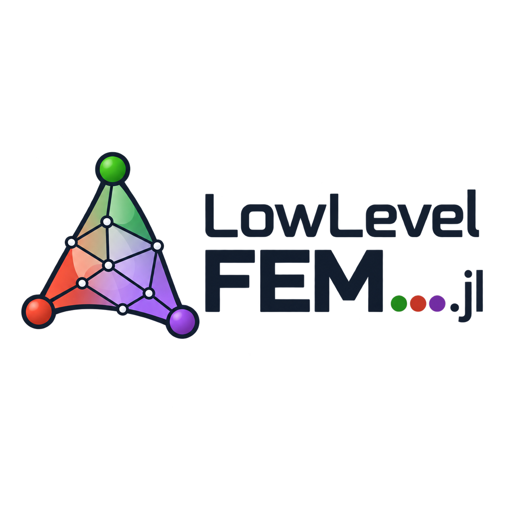

<p align="center">
  
</p>

[](https://github.com/perebalazs/LowLevelFEM.jl/actions/workflows/CI.yml?query=branch%3Amain)
[](https://perebalazs.github.io/LowLevelFEM.jl/dev)
[](https://perebalazs.github.io/LowLevelFEM.jl/stable)
[](https://codecov.io/gh/perebalazs/LowLevelFEM.jl)
[](https://joss.theoj.org/papers/b3ca075c57757edaacbfdf748e1cc6ee)
[](https://doi.org/10.5281/zenodo.17073982)
[](https://opensource.org/licenses/MIT)
[](https://juliapkgstats.com/pkg/LowLevelFEM)

# LowLevelFEM

LowLevelFEM is a Julia package for finite element analysis with an engineering-first workflow,
designed to assemble finite element operators explicitly at matrix and field level.  
It exposes each phase of the workflow as simple functions (mesh → matrices → loads/BCs → solve → postprocess → visualize), so you can customize, combine, or inspect any step **at matrix and field level**.  
Typical tasks such as strain energy or resultants are one-liners (for example, `U = q' * K * q / 2`).
The package is suitable not only for classical structural mechanics problems, but also for rapid assembly of general linear PDEs expressed in weak form.

“Low-level” here refers to direct access to finite element fields, operators, matrices, weak forms, and assembly results, rather than to explicit element-loop programming.

## Scope and audience

LowLevelFEM targets **engineers and researchers doing rapid prototyping** and transparent finite element development. Its primary goal is not extreme-scale HPC, but a direct and inspectable mapping from weak forms and engineering formulations to working code.

Currently, LowLevelFEM uses Gmsh Lagrange basis functions. Hierarchical, spectral, and NURBS bases are not yet part of the current implementation. In practice this is rarely a limitation for classical structural and thermal engineering problems.

Where a choice exists between mathematical generality and straightforward,
inspectable formulas, LowLevelFEM favors the latter — consistent with its
engineering-first, explicit-matrix philosophy described above.

## Requirements

- Julia 1.10+
- Gmsh C API is bundled via `gmsh_jll` and re-exported as `gmsh` from this package; no separate Gmsh.jl installation is required.

## Citation

If you use LowLevelFEM.jl in academic work, please cite the accompanying JOSS paper:

**Balázs Pere (2026).** *LowLevelFEM.jl: A lightweight finite element toolbox in Julia*, Journal of Open Source Software, 11(123), 10096, https://doi.org/10.21105/joss.10096

Citation metadata is provided in `CITATION.cff`.

## Capabilities

LowLevelFEM supports two complementary workflows. **Engineering analyses** can start from familiar models, loads, and results; **weak-form and multifield analyses** can work directly with fields and operators. Both retain access to assembled matrices and intermediate results.

### Engineering analysis

- **Geometry and finite elements:** Gmsh geometry, physical groups, and 2D/3D meshes; line, triangle, quadrangle, tetrahedron, hexahedron, pyramid, and wedge elements with Lagrange interpolation up to order 10.
- **Structural models:** 3D solids, plane stress, plane strain, axisymmetric elasticity, and truss structures; static, transient, and modal workflows where supported.
- **Material behavior and large deformations:** linear elasticity (including user-supplied constitutive matrices); total-Lagrangian geometric nonlinearity and energy-based hyperelastic stress/tangent evaluation. Nonlinear equilibrium and dynamics can be assembled from user-defined state-dependent operators rather than requiring a predefined material/element model for every law.
- **Thermal and coupled problems:** 2D, 3D, and axisymmetric heat conduction; capacity, convection, and latent-heat contributions; thermal expansion, thermal stresses, and heat generation due to elastic deformation.
- **Loads and boundary conditions:** nodal and distributed loads on physical groups, function-defined loading and prescribed histories, elastic supports, initial displacement/velocity/temperature, and local coordinate systems (including spatially varying/curvilinear definitions).
- **Static and transient solution:** direct and iterative linear solvers; consistent or lumped mass, Rayleigh/Caughey damping; HHT-α/Newmark implicit dynamics, central-difference explicit dynamics (CDM), and a θ-method for first-order evolution (FDM). State-dependent operator and right-hand-side callbacks support nonlinear iterations where needed.
- **Eigenproblems:** natural frequencies and mode shapes (including prestressed modal analysis) and linear buckling factors/modes.
- **Contact:** frictionless slave–master contact with closest-point search in the current configuration; penalty and Lagrange-multiplier enforcement, Gauss-point integration, and contact gap/pressure results in 2D/3D.
- **Postprocessing and visualization:** displacement, stress, strain, and heat-flux fields; element-to-node smoothing, resultants and energy calculations, evaluations along paths and on surfaces, and Gmsh views and animations.

### Weak-form and multifield modeling

- **Explicit finite element fields:** user-defined scalar, vector, and tensor fields; nodal and elementwise representations with direct access to their numerical values.
- **Operator-based formulation:** express linear and bilinear weak forms through differential operators (`Grad`, `SymGrad`, divergence, curl, and related field calculus), constitutive coefficients, and the integration operator `∫`.
- **Matrix-level control:** inspect, combine, transform, and reuse assembled stiffness, mass, damping, capacity, coupling, and load operators; no user-written element loops are required for standard weak-form assembly.
- **Multifield and mixed problems:** block `SystemMatrix`/`SystemVector` systems for coupled fields, including mixed-order and Taylor–Hood-type formulations using algebraic p/(p−1) reduction without remeshing.
- **Constraints and transformed spaces:** multi-point constraints (including remote-point and periodic coupling), local coordinate transformations, and reduced approximation spaces; experimental spectral transformations are available for supported line and complete quadrangle elements.
- **Nonlinear and evolving operators:** define and update material, geometric, coupling, and load terms at the operator level. HHT, CDM, and FDM expose `modifyA0`, `modifyA1`, `modifyA2` (where applicable), and `modifyRHS` callbacks; consistent tangent/residual pairs can be supplied explicitly.
- **Efficient sparse assembly:** shared-memory multithreading, direct CSC assembly by default, optional triplet/IJV assembly, and reusable CSC sparsity patterns for repeated matrix construction.

"Low-level" describes access to **fields, weak forms, matrices, and solver inputs**, not a requirement to implement numerical integration or element loops yourself.

## Installation

```julia
using Pkg
Pkg.add("LowLevelFEM")
```

## Quick Start

```julia
using LowLevelFEM

structured_rect_mesh() # uses Gmsh to create mesh

mat = Material("body", E=2e5, ν=0.3)
prob = Problem([mat], type=:PlaneStrain)  # :Solid, :PlaneStress, :AxiSymmetric, :HeatConduction, ...

bc    = displacementConstraint("left", ux=0, uy=0)
force = load("right", fy=-1)

u = solveDisplacement(prob, load=[force], support=[bc])
S = solveStress(u)

showDoFResults(u, visible=true)
showDoFResults(u, :ux)
showStressResults(S)
showStressResults(S, :sxy, name="Shear stress")

openPostProcessor()
```

Note: physical group names in your geometry (created in Gmsh) must match the strings used above (e.g., `"body"`, `"left"`, `"right"`).

### An alternative solution (instead of `u = ...`, `S = ...`)

```julia
K = stiffnessMatrix(prob)
f = loadVector(prob, [force])
u = solveDisplacement(K, f, support=[bc])

E = mat.E
ν = mat.ν

u = expandTo3D(u)

A = (u ∘ ∇ + ∇ ∘ u) / 2
I = TensorField(prob, "body", [1 0 0; 0 1 0; 0 0 1])
S = E / (1 + ν) * (A + ν / (1 - 2ν) * trace(A) * I)
```

### Operator-level weak-form assembly

For custom PDEs and multifield formulations, the finite element operator can
also be assembled directly from its weak form. Differential operators and
coefficient matrices remain explicit, allowing the formulation to be inspected,
modified and combined without implementing a dedicated solver.

```Julia
Pu = Problem([mat], type=:VectorField, dim=2, field=:u)

E = mat.E
ν = mat.ν

C = E / ((1 + ν) * (1 - 2ν)) * [
    1-ν  ν    0
    ν    1-ν  0
    0    0    (1-2ν)/2
]

K = ∫(SymGrad(Pu) ⋅ C ⋅ SymGrad(Pu), Ω="body")
f = ∫(Pu ⋅ [0, -1], Γ="right")
bc = BoundaryCondition("left", ux=0, uy=0)

u = solveField(K, f, support=[bc])
```

Bilinear forms are assembled directly into CSC sparse matrices by default. This
reduces temporary memory use and allows substantially larger problems than
triplet-based assembly. For repeated assembly on the same mesh and field pair,
the sparsity pattern can be built once and reused:

```julia
Kpattern = build_csc_pattern(Pu, Pu; Ω="body")

fill!(Kpattern.nzval, 0.0)
K = ∫(SymGrad(Pu) ⋅ C ⋅ SymGrad(Pu);
      Ω="body", csc_matrix=Kpattern)
```

The pattern must retain its structural zeros; do not call `dropzeros!` on it.
Before an independent reuse, reset its numerical values with `fill!` as shown
above. The previous triplet route remains available with `assembly=:ijv`.

The three examples above solve the same class of problem at different levels of
abstraction:

1. predefined engineering solver,
2. explicit matrices and finite element fields,
3. direct weak-form operator assembly.

The higher-level functions are convenience wrappers; the underlying matrices,
fields and operators remain accessible throughout the workflow.

### For interactive work with custom geometries

Gmsh can be launched directly from Julia.

```julia
openGeometry("test.geo")
openPreProcessor()
```

If `test.geo` already exists, it is opened for editing. Otherwise, `openGeometry` automatically creates a new geometry file, which can then be edited in Gmsh using `openPreProcessor()`.

This workflow is recommended for custom geometries and more advanced finite element models.

More end-to-end examples, tutorials and application notebooks are available in the
[examples](https://github.com/perebalazs/LowLevelFEM.jl/tree/main/examples) directory
and the online [documentation](https://perebalazs.github.io/LowLevelFEM.jl/stable/).

## Documentation

* Latest docs: [https://perebalazs.github.io/LowLevelFEM.jl/dev](https://perebalazs.github.io/LowLevelFEM.jl/dev)
* Stable docs: [https://perebalazs.github.io/LowLevelFEM.jl/stable](https://perebalazs.github.io/LowLevelFEM.jl/stable)

## Planned features

* Spectral Element Method

Any [suggestions](https://github.com/perebalazs/LowLevelFEM.jl/discussions) are welcome.
In case of any issue, please send a [bug report](https://github.com/perebalazs/LowLevelFEM.jl/issues).

## License

This project is licensed under the MIT License — see `LICENSE` for details.
